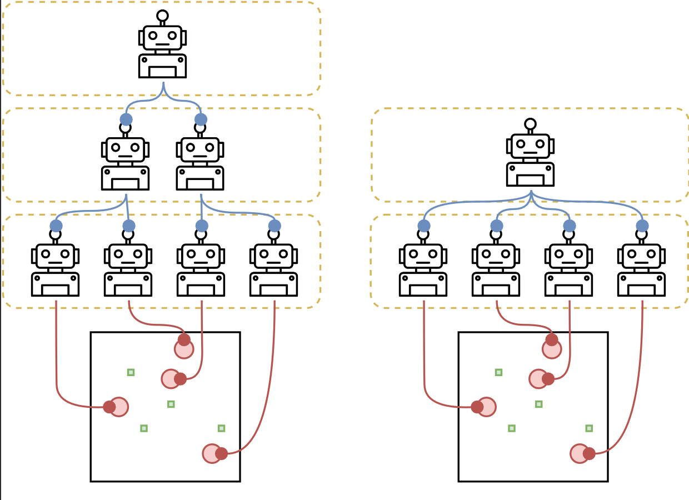

# TAG (TAME Agent Framework)

[](LICENSE)

[](https://www.python.org/downloads/)

TAG is a framework for implementing decentralized hierarchical multi-agent reinforcement learning systems. It enables the creation of hierarchical agents with arbitrary depth through a novel LevelEnv abstraction, which presents each level of the hierarchy as an environment to the level above it.

You can find the paper here: [https://arxiv.org/abs/2502.15425](https://arxiv.org/abs/2502.15425)



## Features

- Build hierarchical multi-agent systems with arbitrary depth
- Standardized information flow between levels via the LevelEnv abstraction
- Support for heterogeneous agents across different levels
- Flexible communication protocol between hierarchy levels
- Compatible with standard RL environments (OpenAI Gym, PettingZoo)
- Built-in implementations of common baseline agents (PPO, MAPPO)

## Why TAG?

TAG offers several unique advantages over existing hierarchical reinforcement learning frameworks:

1. **Arbitrary Hierarchy Depth**: Unlike traditional approaches limited to two-level manager/worker architectures, TAG supports hierarchies of arbitrary depth through the novel LevelEnv abstraction.

2. **Fully Decentralized Design**: TAG maintains agent autonomy at every level, allowing each agent to learn independently without requiring centralized training. This enables better scalability compared to centralized approaches like CTDE (Centralized Training, Decentralized Execution).

3. **Standardized Information Flow**: The LevelEnv abstraction creates a uniform interface between hierarchy levels, facilitating clear bidirectional communication—bottom-up through messages and top-down through actions.

4. **Heterogeneous Agent Support**: TAG enables seamless integration of different agent types (e.g., PPO, MAPPO, LLM agents) across various levels, allowing you to match agent capabilities to the requirements of each level.

5. **Loose Coupling Between Levels**: Each level in the hierarchy operates with relative independence, reducing complexity and allowing for more efficient learning across different temporal scales.

6. **Biological Inspiration**: Based on principles from TAME (Technological Approach to Mind Everywhere) that reflect how biological systems organize hierarchically, TAG creates more natural coordination mechanisms compared to traditional approaches.

These features make TAG particularly well-suited for complex multi-agent tasks requiring coordination across different scales and abstraction levels.

## Installation

```bash
pip install tame-agent
```

For development installation:

```bash
# Clone the repository
git clone https://github.com/yourusername/tame

# Create a conda environment (recommended)
conda create --name tag python=3.10

# Install in editable mode with development requirements
pip install -e .[dev]

# Install pre-commit hooks (for development)
pre-commit install -t pre-commit -t pre-push
```

## Getting Started

We provide a series of tutorials in the [tutorials/](./tutorials/) directory to help you get started with TAG:

1. [Intro to the concepts of TAG](./tutorials/01_concepts.ipynb): An introduction to the core concepts of TAG
   - Understanding hierarchical RL
   - The LevelEnv abstraction
   - Information flow between levels
   - Communication mechanisms

2. [Quick start](./tutorials/02_quick_start.ipynb):  How to quickly configure and launch experiments with the provided agents
   - Launch an experiment
   - How the configuration of and experiment works

3. [Build a hierarchy](./tutorials/03_build_a_hierarchy.ipynb): A step-by-step guide to building your first hierarchical agent
   - Creating a simple 2-level hierarchy
   - Configuring agents at each level
   - Basic training and evaluation

4. [Make your agents](./tutorials/04_make_your_agents.ipynb): Exploring how to create your own agents for the hierarchy
   - Custom BaseAgents
   - Custom LevelAgents


For specific implementations and environment-specific examples, check out the codebase under `src/tame/agents/` and `src/exp_configs/`. These include:
- MPE Simple Spread environment (`mpe_simple_spread/`)
- VMAS Balance environment (`vmas_balance/`)
- Various agent implementations (PPO, MAPPO, etc.)

## Documentation
[](https://GPaolo.github.io/TAG_Framework)

We use pdoc for API documentation. 
You can find the full API documentation [here](https://GPaolo.github.io/TAG_Framework)

## Examples

We provide several implementations in the [tame/agents/](./src/tame/agents/) directory.


## Running Experiments

You can run experiments using the `scripts/run_experiment.py` script:

```bash
python scripts/run_experiment.py \
    --config-path src/exp_configs/mpe_simple_spread \
    --config-name cfg_3ppo_221 \
    --n-agents 4 \
    --seed 42 \
    --cuda 0
```

## Contributing

We welcome contributions! Please open a Pull Request or an Issue.

## Citation

If you use TAG in your research, please cite:

```bibtex
@article{tag2024,
  title={TAG: A Decentralized Framework for Multi-Agent Hierarchical Reinforcement Learning},
  author={Giuseppe Paolo, Abdelhakim Benechehab, Hamza Cherkaoui, Albert Thomas, Balázs Kégl},
  journal={Under review by the International Conference on Machine Learning (ICML)},
  year={2025}
}
```
## License

This project is licensed under the MIT License - see the [LICENSE](LICENSE) file for details.
